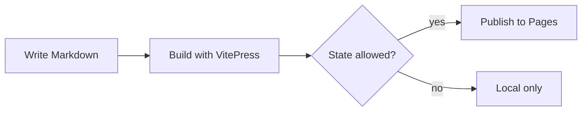
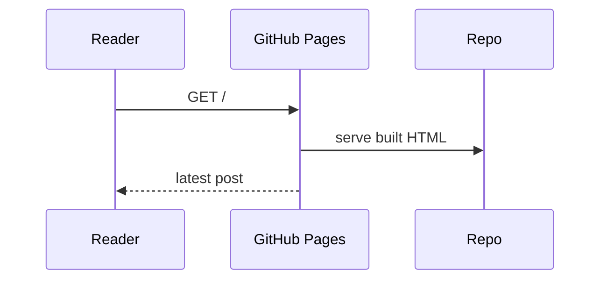

# Rendering test (H1)

This page exercises the Markdown and Mermaid features the site relies on. It
carries `state: local`, so it renders only when served locally and never ships
to production. Use it to spot rendering regressions after upgrades.

## Headings

### Heading level 3

#### Heading level 4

## Emphasis

Plain text with **bold**, _italic_, **_bold italic_**, and ~~strikethrough~~.

## Lists

Unordered, with nesting:

- First item
- Second item
  - Nested item
  - Another nested item
- Third item

Ordered:

1. Step one
2. Step two
3. Step three

Task list:

- [x] Completed task
- [ ] Pending task
- [ ] Another pending task

## Table with alignment

| Feature | Supported | Notes            |
| :------ | :-------: | ---------------: |
| Tables  |    yes    |     left/center/right |
| Mermaid |    yes    |      via plugin |
| Footnotes |  yes    |          GFM-ish |

## Blockquote

> Boring is a compliment here.
>
> > Nested blockquotes work too.

## Code

Inline `const x = 1` code, and a fenced block with a language:

```ts
function greet(name: string): string {
  return `Hello, ${name}.`
}
```

## Links and images

An inline [link to the home page](/), a reference-style
[link to GitHub][gh], and an autolinked URL: https://boringsteps.org.

The brand mark:


[gh]: https://github.com/bernard357/boringsteps

## Footnotes

Here is a statement with a footnote.[^note]

[^note]: This is the footnote text, rendered at the bottom of the page.

## Horizontal rule

---

## Mermaid — flowchart



## Mermaid — sequence diagram


